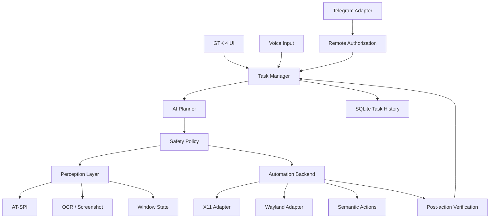

# UthyAgent Desktop

UthyAgent is a local-first AI desktop automation app for Zorin OS 18.1 Core and compatible Linux desktops. It accepts natural-language tasks, observes the desktop through supported accessibility and screen-capture interfaces, executes actions through pluggable backends, and verifies each step.

## Status

This directory is the initial Linux-native application scaffold. Desktop automation is backend-dependent and must be tested on the target session. The Android-only APK and AccessibilityService onboarding from the PrivateAgent reference are not part of this Linux build.

## Design principles

- Local-first configuration, task history, and memory stored on the user's machine.
- Provider-agnostic AI configuration with OpenAI-compatible endpoints and local Ollama/LM Studio endpoints.
- Prefer AT-SPI semantic controls, then OCR/vision, then validated coordinate actions.
- Keep execution observable with action tooltips, screenshots, step status, and an emergency stop.
- Run as the logged-in user. Never require root for ordinary desktop interaction.
- Require explicit approval for destructive actions, sending messages, purchases, and privileged commands.
- Use raised 3D soft-clay icon artwork without icon frames. Never use sparkle icons.
- Liquid Glass-inspired surfaces must retain readable contrast and support reduced motion.

## Requirements

- Zorin OS 18.1 Core or a compatible Linux desktop.
- Python 3.11 or newer.
- GTK 4, libadwaita, PyGObject, and an active graphical user session.
- AT-SPI services for semantic accessibility where supported.
- Optional: Tesseract OCR, xdotool for X11, Telegram bot token, and an AI provider API key.
- Network access for remote providers and Telegram. Local providers can run without cloud inference.

## Development setup on Ubuntu/Zorin

Install system dependencies:

```bash
sudo apt update
sudo apt install -y python3 python3-venv python3-pip python3-gi python3-gi-cairo gir1.2-gtk-4.0 gir1.2-adw-1 gir1.2-atspi-2.0 gir1.2-secret-1 git
```

Optional tools:

```bash
sudo apt install -y tesseract-ocr xdotool
```

Run the application:

```bash
cd desktop-agent
python3 -m venv .venv
. .venv/bin/activate
pip install -e .
python -m uthyagent
```

PyGObject and GTK bindings are best installed from the distribution packages rather than pip when using system GTK libraries.

## Planned capabilities

1. GTK 4/libadwaita desktop UI.
2. Provider settings for base URL, API key, model ID, connection testing, and model discovery.
3. Task planner, action executor, and verifier.
4. AT-SPI element discovery and semantic activation.
5. OCR and screenshot perception fallback.
6. X11 and supported Wayland automation adapters.
7. Text input, push-to-talk voice input, and optional Telegram remote commands.
8. Local SQLite task history and Secret Service credential storage.
9. User-level systemd background service.
10. CI packaging for Debian, RPM, and AppImage.

## Architecture



## Packaging

GitHub Actions is intended to build artifacts in CI. No release binaries are committed until the workflows have successfully built and tested them. Flathub submission requires a reviewed Flatpak manifest, reproducible build instructions, app metadata, screenshots, and a submission through the Flathub process.

## License and upstream

Review the license and notices of https://github.com/orailnoor/private-agent before copying code. This scaffold documents an independently implemented Linux architecture inspired by the reference's observe-act-verify loop. Do not copy upstream code until its license terms have been checked and attribution requirements are met.
