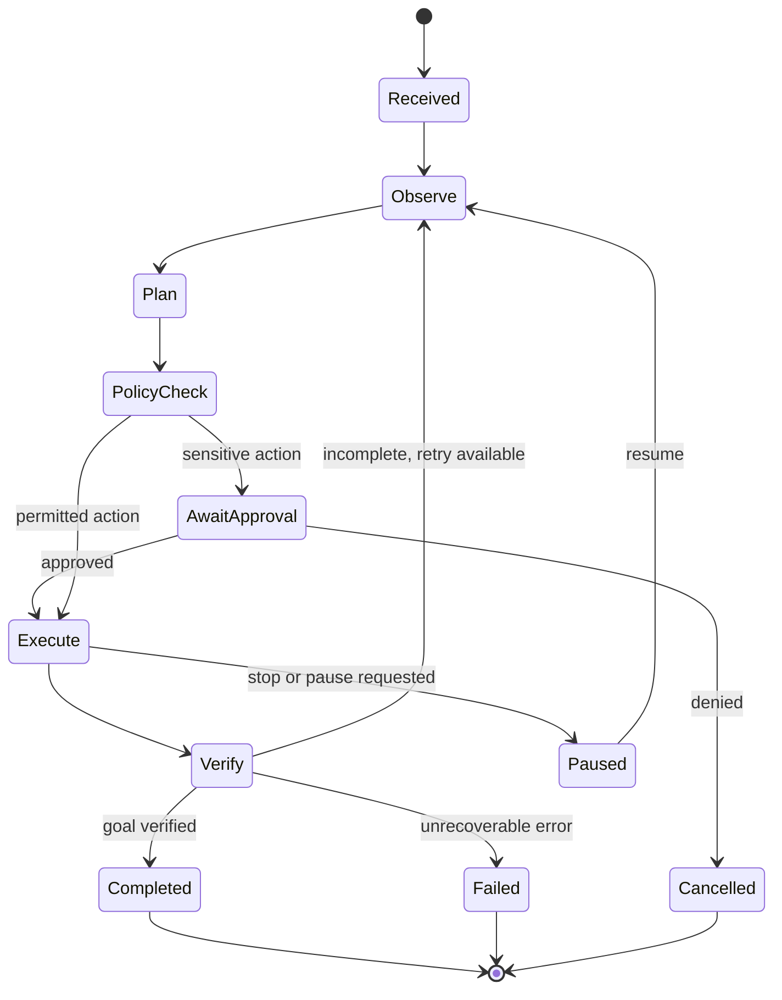

# UthyAgent Architecture

## Task lifecycle

## Perception and action priority

1. Query the AT-SPI accessibility tree for names, roles, states, and bounds.
2. Use supported application APIs or keyboard navigation where available.
3. Use OCR and screenshots to identify visible text and candidate targets.
4. Use coordinate-based interaction only after checking the active window, screenshot freshness, target bounds, and display scaling.
5. Re-observe after every state-changing action.

## Mouse tooltip requirements

Every automation action should publish a structured event containing task ID, action type, target description, coordinates when relevant, reason summary, timestamp, and outcome. The UI displays a transient tooltip or target annotation near the pointer. The annotation must not block the target, must time out, and must be disabled by a reduced-motion/accessibility setting. Do not display private prompt contents or secrets in the tooltip.

## Security boundaries

- Run in the user's session, not as root.
- Keep provider keys in the desktop Secret Service.
- Telegram commands require an explicit user ID allowlist.
- Treat screen content and webpages as untrusted data, not instructions.
- Confirm irreversible operations and externally visible communications.
- Apply per-task timeouts, step limits, and cancellation checks.
- Log structured outcomes with secrets redacted.

## Wayland and X11

Linux desktop automation is session-dependent. AT-SPI semantic actions are preferred. X11 tools such as xdotool are optional and only apply to X11 sessions. Wayland input injection is restricted by design and must use supported portal/compositor APIs or documented user-authorized mechanisms. Never promise unrestricted control across every application or desktop session.

## Local-first data

SQLite stores task history and user preferences. Secret Service stores credentials. Screenshots are ephemeral by default and are retained only when the user enables history capture. Remote model providers receive only the context needed for the task and must be clearly identified in settings.
