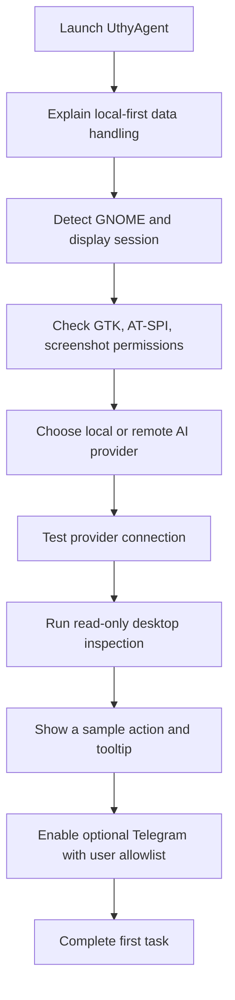
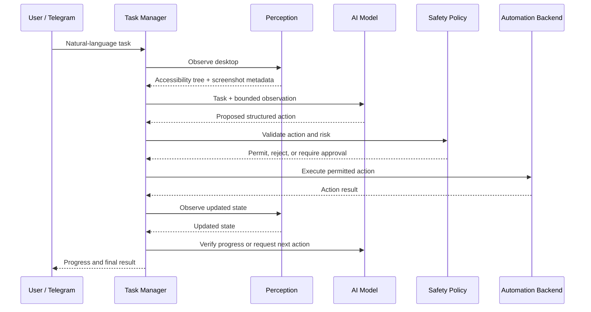

# UthyAgent Wireframes and User Flows

## Home

```text
┌──────────────────────────────────────────────────────────────────────────┐
│ UthyAgent                                      Provider: OpenRouter  ●   │
├──────────────────────┬───────────────────────────────────────────────────┤
│ Home                 │ Desktop agent                                    │
│ Agent Chat           │ Describe a task. UthyAgent observes, acts, verifies│
│ Live Computer Use    │                                                   │
│ Tasks                │ ┌───────────────────────────────────────────────┐ │
│ Workflows            │ │ Type a natural-language task...               │ │
│ Agents               │ │                                               │ │
│ Integrations         │ │ [Start task] [Voice input] [Emergency stop]   │ │
│ Activity Logs        │ └───────────────────────────────────────────────┘ │
│ Settings             │                                                   │
│                      │ Execution activity                                │
│                      │ ┌───────────────────────────────────────────────┐ │
│                      │ │ Idle / Observe / Plan / Act / Verify          │ │
│                      │ │ Current app, action tooltip, last result      │ │
│                      │ └───────────────────────────────────────────────┘ │
└──────────────────────┴───────────────────────────────────────────────────┘
```

## Live Computer Use

```text
┌──────────────────────────────────────────────────────────────────────────┐
│ Task: Find the latest project log                              [Pause]  │
├──────────────────────────────┬───────────────────────────────────────────┤
│ TASK TIMELINE                │ LIVE DESKTOP                              │
│  ✓ Opened file manager       │ ┌───────────────────────────────────────┐ │
│  ● Searching for logs        │ │ Screenshot / accessible target overlay│ │
│  ○ Verify result             │ │                                       │ │
│                              │ │         [target highlight]             │ │
│ Current action               │ └───────────────────────────────────────┘ │
│ "Clicking search field"      │ Active app: Files                         │
│ Target: Search entry         │ Target bounds: x, y, width, height        │
│                              │                                           │
│ [Pause] [Cancel] [Details]   │ [Refresh screenshot] [Copy diagnostics]   │
└──────────────────────────────┴───────────────────────────────────────────┘
```

## Provider setup

```text
┌──────────────────────────────────────────────────────────────┐
│ Settings / AI Provider                                       │
│                                                              │
│ Provider     [OpenRouter                  v]                 │
│ Base URL     [https://openrouter.ai/api/v1]                  │
│ API key      [••••••••••••••••             Show]              │
│ Model        [openrouter/free             v]                 │
│                                                              │
│ [Fetch models] [Test connection]                              │
│                                                              │
│ Local-first: [ ] Prefer local endpoint when available        │
│ [Save provider]                                               │
└──────────────────────────────────────────────────────────────┘
```

## First-run flow



## Task execution flow


